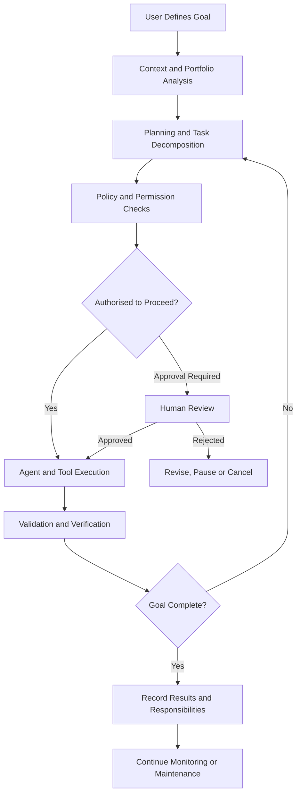

# ❄️ Snow-Storm

### A Goal-Driven AI Operating System

**Snow-Storm is an AI orchestration platform designed to turn goals into coordinated, persistent, and measurable work across an entire organisation.**

Instead of manually configuring individual agents, tools, workflows, and tasks, users define what they want to achieve. Snow-Storm determines how to approach the objective, coordinates the necessary work, and manages responsibilities across projects and services within explicitly defined boundaries.

Snow-Storm aims to make AI a persistent operational capability rather than a collection of disconnected conversations.

> **Define the goal. Let Snow-Storm coordinate the work. Stay in control.**

---

## 📖 Table of Contents

- [Vision](#-vision)
- [The Problem](#-the-problem)
- [Core Principles](#-core-principles)
- [How Snow-Storm Works](#-how-snow-storm-works)
- [Core Capabilities](#-core-capabilities)
- [Conceptual Architecture](#-conceptual-architecture)
- [Autonomy, Permissions and Safety](#-autonomy-permissions-and-safety)
- [Example Use Cases](#-example-use-cases)
- [Design Philosophy](#-design-philosophy)
- [Development Roadmap](#-development-roadmap)
- [Project Status](#-project-status)
- [Contributing](#-contributing)
- [License](#-license)

---

## 🌨️ Vision

The long-term vision for Snow-Storm is an AI operating system that coordinates work across an entire organisation.

An organisation may contain dozens of projects, applications, services, infrastructure components, and operational responsibilities. Each has its own objectives, dependencies, deadlines, and ongoing maintenance requirements.

Snow-Storm is designed to provide a unified layer for managing that complexity.

A user should be able to express an outcome in natural language, refine it through conversation, inspect the resulting plan visually, and allow Snow-Storm to execute authorised work.

For example:

> "Build a secure authentication service, integrate it with our existing applications, write the tests, deploy it to staging, and keep monitoring it for issues."

Snow-Storm should be able to translate that goal into a structured plan, identify the affected projects, coordinate appropriate agents and tools, track dependencies, validate results, and maintain the service's ongoing responsibilities.

The user defines the desired outcome and acceptable boundaries. Snow-Storm manages the coordination required to achieve it.

### The fundamental idea

**AI should manage outcomes, not merely respond to instructions.**

This means moving beyond single prompts and isolated agent executions toward a persistent system that understands what needs to happen, what is already happening, what remains unfinished, and what it is authorised to do next.

---

## 🧩 The Problem

Modern AI tools are powerful, but coordinating them across real projects remains difficult.

Common challenges include:

- **Fragmented workflows:** Projects, conversations, agents, and tools operate independently.
- **Manual orchestration:** Users must decide which agent to invoke, which tool to use, and what happens next.
- **Lost continuity:** Work loses context when sessions end, models restart, or tasks move between agents.
- **Limited visibility:** Understanding the status, dependencies, and ownership of work across multiple projects is difficult.
- **Unbounded or overly restricted autonomy:** Systems may either require excessive approval or act without sufficiently clear boundaries.
- **Operational drift:** Completed projects still need maintenance, monitoring, updates, and follow-up work.

Snow-Storm aims to address these challenges through persistent ownership, goal-driven planning, coordinated execution, and bounded autonomy.

---

## 🧭 Core Principles

These principles define the intended behaviour of Snow-Storm and guide future architectural decisions.

### 1. Goal-First

Users define **what they want to achieve**, rather than manually configuring every agent, tool, and workflow.

Snow-Storm translates outcomes into plans, responsibilities, and executable work. Users can refine the plan when necessary without having to manage every implementation detail.

### 2. Portfolio-Wide

Snow-Storm operates across an organisation's entire portfolio of work.

An organisation may contain multiple projects, repositories, applications, services, infrastructure components, and operational responsibilities. Snow-Storm should understand their relationships and coordinate work across them.

A task should not be treated as an isolated unit when its success depends on the wider system.

### 3. Conversational and Visual

Users can interact with Snow-Storm through both natural-language conversation and a visual management interface.

Conversation supports exploration, goal definition, clarification, and direction. The visual interface provides visibility into plans, project relationships, task progress, agent activity, permissions, and operational health.

Both interfaces operate on the same underlying state.

### 4. Persistent Ownership

Projects and responsibilities continue to exist beyond individual sessions, conversations, and model restarts.

Snow-Storm should preserve the state required to resume work, understand outstanding responsibilities, and maintain continuity. Where appropriate, it should recognise recurring work, unresolved issues, and obligations that remain after an initial goal has been completed.

Persistence means retaining operational responsibility, not merely storing chat history.

### 5. Bounded Autonomy

Snow-Storm may act independently within explicitly defined permissions, budgets, and policies.

Autonomy is granted through enforceable boundaries rather than assumed from an agent's capabilities. Actions outside those boundaries require the appropriate approval or must be rejected.

The objective is useful independence without surrendering control.

---

## ⚙️ How Snow-Storm Works

Snow-Storm is envisioned as a continuous operational cycle rather than a one-shot prompt executor.

1. **Define the goal** — A user describes an outcome, desired constraints, and relevant priorities.
2. **Understand the context** — Snow-Storm identifies affected projects, existing responsibilities, dependencies, and available capabilities.
3. **Develop a plan** — The system breaks the goal into manageable tasks with clear ownership and completion criteria.
4. **Coordinate execution** — Appropriate agents, tools, and services perform authorised work.
5. **Validate the results** — Work is checked against its acceptance criteria, policies, and dependencies.
6. **Update operational state** — Progress, decisions, results, and outstanding responsibilities are recorded.
7. **Continue or escalate** — Snow-Storm proceeds with eligible work, adapts to new information, or requests human intervention when necessary.

This cycle can repeat until the goal is achieved, the work is cancelled, or an explicit stopping condition is reached.

### From goals to execution

*This diagram describes the intended workflow, not an implemented execution pipeline.*

---

## 🚀 Core Capabilities

The following capabilities define the intended product direction. Their presence in this README does not imply that they have already been implemented.

### Goal and Plan Management

- Define goals through natural language.
- Translate goals into structured plans and tasks.
- Track milestones, dependencies, and acceptance criteria.
- Revise plans as requirements or circumstances change.
- Connect individual tasks to larger organisational objectives.

### Portfolio Management

- Organise work across multiple projects and repositories.
- Represent relationships between components, services, and responsibilities.
- Identify cross-project dependencies and potential conflicts.
- Maintain visibility into progress across the organisation.
- Track work that spans multiple teams, agents, or technical environments.

### Agent and Tool Orchestration

- Assign work according to task requirements and available capabilities.
- Coordinate agents and tools through a common orchestration layer.
- Manage task dependencies, execution state, retries, and failures.
- Validate deliverables before marking work complete.
- Support different execution strategies without tying the product to a single AI model.

### Persistent Operations

- Resume work after sessions or model restarts.
- Maintain durable task and project state.
- Track unresolved issues and unfinished responsibilities.
- Support recurring and event-driven work.
- Preserve the history needed to understand decisions and execution outcomes.

### Conversational and Visual Management

- Discuss goals, constraints, and proposed plans conversationally.
- Inspect projects, tasks, dependencies, and execution status visually.
- Approve, reject, pause, or redirect work.
- Investigate failures and review results.
- Provide consistent state across conversational and visual interfaces.

### Governance and Resource Control

- Apply permissions at appropriate organisational and resource boundaries.
- Enforce execution budgets and resource limits.
- Require approval for designated high-impact actions.
- Record significant decisions and actions for auditability.
- Stop or constrain work that exceeds its authorised scope.

---

## 🏗️ Conceptual Architecture

Snow-Storm is intended to separate organisational intent, planning, orchestration, execution, and persistent state.

The exact implementation and technology choices remain open to architectural validation.

| Component | Intended responsibility |
|---|---|
| **User Interface** | Conversational interaction and visual operational management. |
| **Goal and Planning Layer** | Translate objectives into plans, tasks, and measurable completion criteria. |
| **Portfolio and Context Layer** | Represent projects, resources, dependencies, and existing responsibilities. |
| **Orchestration Engine** | Coordinate execution, dependencies, scheduling, retries, and task state. |
| **Agent and Tool Adapters** | Connect the orchestration engine to execution agents, models, and external tools. |
| **Policy and Permission Layer** | Determine which actions are allowed, restricted, or require approval. |
| **Persistent State Layer** | Store durable operational state, plans, ownership, and execution history. |
| **Observability and Audit Layer** | Record activity, outcomes, failures, resource usage, and relevant decisions. |

These are logical responsibilities, not necessarily separate deployable services. The initial implementation should favour clear boundaries and a manageable architecture over premature distribution.

### Architectural objectives

The architecture should aim to provide:

- **Model independence:** Orchestration should not depend on a single model provider.
- **Replaceable components:** Agents, tools, and integrations should be replaceable behind well-defined interfaces.
- **Durable execution:** Work should survive process failures and recover from interrupted execution.
- **Explicit state transitions:** Task and workflow state should be predictable and auditable.
- **Policy enforcement:** Permission checks should be enforced by the system, not left solely to model instructions.
- **Extensibility:** New capabilities should integrate without requiring a redesign of the entire platform.

---

## 🔐 Autonomy, Permissions and Safety

Autonomy is a foundational capability of Snow-Storm, but it must remain governed by explicit rules.

A capable agent is not automatically an authorised agent.

Snow-Storm should distinguish between what an agent *can* do, what it *wants* to do, and what the system *permits* it to do.

### Boundaries of autonomous execution

Execution policies should support:

- **Permissions:** Which resources and actions are accessible.
- **Budgets:** Maximum authorised resource consumption or expenditure.
- **Approval requirements:** Which actions require human authorisation.
- **Scope restrictions:** Which projects, environments, and responsibilities are included.
- **Stopping conditions:** When execution must stop, pause, or escalate.
- **Auditability:** What happened, which identity or agent initiated it, and what outcome followed.

### Human oversight

Human intervention should be deliberate and risk-based.

Routine, reversible work may be eligible for autonomous execution when it falls within approved policies. Actions with significant security, financial, operational, or irreversible consequences should receive stronger controls.

When Snow-Storm cannot safely determine how to proceed, it should communicate the uncertainty and request the appropriate decision rather than silently expanding its authority.

---

## 💡 Example Use Cases

These examples illustrate the intended capabilities of Snow-Storm.

### Software Development

**Goal:** Deliver a new feature across an existing application.

Snow-Storm identifies the relevant repositories, breaks the feature into tasks, coordinates implementation and testing, checks dependencies, and tracks the result against the requested requirements.

### Infrastructure and Operations

**Goal:** Maintain a development environment and keep its services healthy.

Snow-Storm tracks operational responsibilities, monitors available signals, coordinates authorised maintenance, and escalates incidents that exceed its permissions or response policies.

### Cross-Project Coordination

**Goal:** Introduce a shared authentication service across several applications.

Snow-Storm identifies affected components, plans the migration, coordinates implementation across projects, and tracks dependencies until the integration is verified.

### Continuous Improvement

**Goal:** Keep a software portfolio maintainable and secure.

Snow-Storm can be designed to identify outstanding maintenance work, organise improvements by priority, and coordinate approved changes while preserving visibility and control across the portfolio.

---

## 🧠 Design Philosophy

Snow-Storm should be built around a few important distinctions.

**A goal is not a task.** A goal describes a desired outcome; tasks are the work required to achieve it.

**An agent is not an organisation.** Agents perform work, but the platform must manage ownership, dependencies, policies, and continuity across all of them.

**Completion is not the end of responsibility.** Some outcomes introduce ongoing obligations, such as monitoring, maintenance, and periodic reviews.

**Persistence is more than memory.** Remembering a conversation is not equivalent to preserving a reliable operational state from which work can resume.

**Autonomy is not unrestricted access.** Independent execution must remain within enforceable permissions, budgets, and policies.

**Models are replaceable; operational state must endure.** Changing a model or restarting an agent should not erase the organisation's work, ownership, or history.

These distinctions should guide product design, architecture, and implementation decisions.

---

## 🗺️ Development Roadmap

Snow-Storm is currently at the project-definition stage. The following roadmap is proposed and may change as requirements and technical decisions are validated.

### Phase 1 — Foundations

- Formalise product requirements and system boundaries.
- Define core domain entities and relationships.
- Specify goals, projects, tasks, responsibilities, and execution states.
- Define permission, budget, and approval models.
- Establish architectural decisions and development standards.

### Phase 2 — Minimum Viable Platform

- Implement persistent projects and tasks.
- Introduce goal definition and basic task planning.
- Build a controlled orchestration and execution loop.
- Add basic conversational interaction.
- Record task outcomes and execution history.

### Phase 3 — Coordinated Execution

- Support multiple agents and tools.
- Implement task dependencies and scheduling.
- Add failure handling, retries, and recovery.
- Introduce validation against completion criteria.
- Expand execution policies and human approval workflows.

### Phase 4 — Portfolio Management

- Support multiple projects and connected resources.
- Visualise dependencies, responsibilities, and progress.
- Coordinate work across project boundaries.
- Introduce recurring responsibilities and operational monitoring.

### Phase 5 — Advanced Autonomy

- Improve planning and adaptive execution.
- Introduce event-driven workflows.
- Expand observability, governance, and resource optimisation.
- Evaluate more advanced coordination strategies against measurable reliability and safety criteria.

**Roadmap status:** Proposed. No phase should be considered complete until its acceptance criteria have been met.

---

## 📍 Project Status

**Current stage:** Initial project definition and repository setup.

The repository is being established around the Snow-Storm product vision and initial requirements. The implementation roadmap is intended to guide development from a clearly defined foundation toward a functioning orchestration platform.

At this stage:

- Product vision and foundational principles are defined.
- Initial capability areas and architectural responsibilities are outlined.
- The implementation architecture remains subject to validation.
- Features described in this README are proposed capabilities unless separately documented as implemented.

The README will evolve alongside the actual implementation. Architecture diagrams, setup instructions, API documentation, and contribution guidance should be expanded as the relevant components become available.

---

## 🤝 Contributing

Snow-Storm is intended to be developed through a disciplined, incremental engineering process.

Contributions should favour clarity, reliability, maintainability, and well-defined responsibilities.

Before contributing, consider the following principles:

1. **Respect the product vision.** Features should support goal-driven, portfolio-wide, persistent, and bounded orchestration.
2. **Prefer clear interfaces.** Components should have explicit responsibilities and minimise unnecessary coupling.
3. **Design for failure.** Execution may be interrupted, agents may fail, and tools may return incomplete results.
4. **Preserve operational state.** Important state transitions and execution outcomes should be durable.
5. **Enforce security boundaries.** Permissions and approval requirements must be enforced independently of model-generated intentions.
6. **Validate outcomes.** Work should be measured against explicit acceptance criteria.
7. **Document important decisions.** Architectural changes should explain their motivation, trade-offs, and consequences.

Detailed contribution instructions, development setup, testing requirements, and code review procedures will be added as the repository becomes operational.

---

## 📜 License

The project license has not yet been specified.

Until a license is added to the repository, the intended distribution and reuse permissions should not be assumed. The license should be established before publicly distributing code for reuse.

---

## ❄️ Snow-Storm

Snow-Storm aims to make AI a persistent, coordinated operational layer for getting work done.

Not simply an agent that executes a prompt. Not just a workflow builder. Not merely a dashboard for managing AI tools.

**A goal-driven system that coordinates work, maintains responsibility, and operates within boundaries defined by its users.**

*Define the outcome. Coordinate the work. Keep control.*
